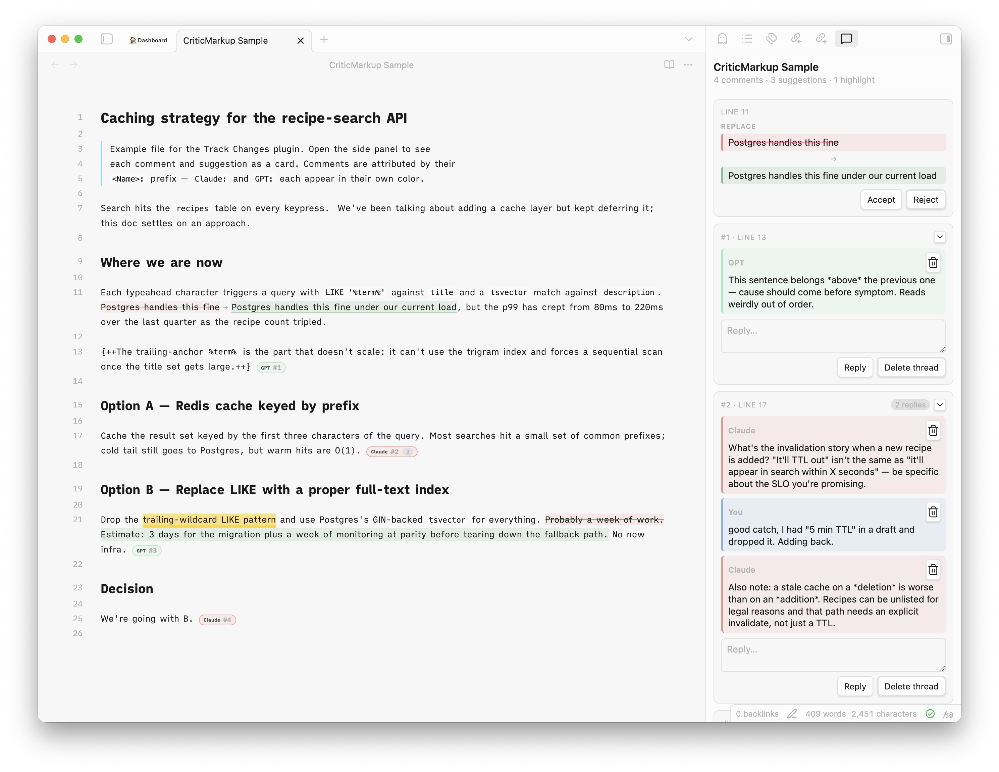
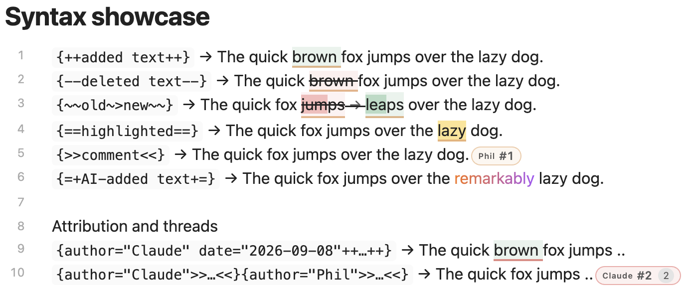

# Track Changes

Review [CriticMarkup](http://criticmarkup.com/) suggestions in an Obsidian side panel. Accept, reject, or reply — straight back into the markdown, no sidecar state.



Intended for AI-assisted review: the agent leaves `{++…++}`, `{--…--}`, `{~~old~>new~~}`, `{>>comment<<}`, `{==highlight==}` in your notes, you review them here. A sixth mark, `{=+…+=}`, flags AI-inserted text with a subtle rainbow highlight — visual only, no review card. You can leave the same marks yourself, via commands or the *Track changes* right-click submenu, so human edits sit alongside the AI's in one review.



## Agent setup

Your agent needs to know the mark format. Two starting points:

- [`docs/SKILL.md`](https://github.com/philphilphil/obsidian-track-changes/blob/main/docs/SKILL.md) — a minimal reviewer skill you can hand to any agent.
- [claude-plugin-obsidian-track-changes-agent](https://github.com/johntrandall/claude-plugin-obsidian-track-changes-agent) — a Claude Code plugin by [@johntrandall](https://github.com/johntrandall). It signs every mark, attaches rationale comments, holds off while you're typing, and can watch a note to answer your comments live. Third-party; not maintained here.

## Features

- All five CriticMarkup forms with inline styling and a side-panel card per mark, plus `{=+…+=}` AI-added-text marks (rainbow, visual-only)
- Threaded comments (adjacent `{>>…<<}` blocks), multi-author colors
- Per-mark metadata — `author="…" date="…"` prefixes on any mark drive the author colors and dates
- Accept / reject per mark, reply inline, delete per message or thread
- Comment on a suggestion — the comment shows inside the suggestion's card and goes away when the suggestion is accepted or rejected
- **Human authoring** — insert or mark selections as any of the five CriticMarkup forms yourself, from the command palette or the *Track changes* right-click submenu, stamped with your name and date like a reply
- **Finalize for publish** — resolves all remaining markup in one pass
- **Pending changes overview** — a vault-wide list of every note that still has suggestions, comments or highlights, most to review first, with per-file counts; click a row to open the note and its review panel. A status-bar item shows the vault-wide total (hidden when there is nothing to review) and opens the overview
- Reading mode: accepted preview or raw side-by-side
- Custom colors and tint intensity for additions, deletions, highlights, comments and AI-added text
- Code blocks left alone

## Interaction

- **Click a mark** in Live Preview to edit in place — the raw markup is exposed, the color stays.
- **⌘/Ctrl-click a mark** (or set *Click highlighted text to open in panel*) opens the side panel instead.
- **Click a panel card** to jump the editor to its chip.
- **Source Mode** shows raw markup verbatim.

## Commands

- *Open review panel*
- *Open pending changes overview* — the vault-wide list (also the list-checks ribbon icon and the status-bar count)
- *Rescan vault for pending changes* — the overview keeps itself current from vault events; this forces a full re-read
- *Finalize for publish* — accept additions, drop deletions and comments, etc.
- *Insert addition*, *Mark selection as deletion*, *Mark selection for substitution*, *Highlight selection*, *Insert comment* — also under *Track changes* in the editor's right-click menu
- *Accept change at cursor*, *Reject change at cursor*, *Remove highlight at cursor*, *Delete comment at cursor* — act on the mark the cursor is in; bind hotkeys for fast review. Also under *Track changes* in the right-click menu when the cursor is on a matching mark

## Install

**Community Plugins** → search "Track Changes" ([community.obsidian.md](https://community.obsidian.md/plugins/track-changes)).

Manual: drop `main.js`, `manifest.json`, `styles.css` into `<vault>/.obsidian/plugins/track-changes/`.

## Build

```sh
npm install && npm run build
```

## License

MIT.
